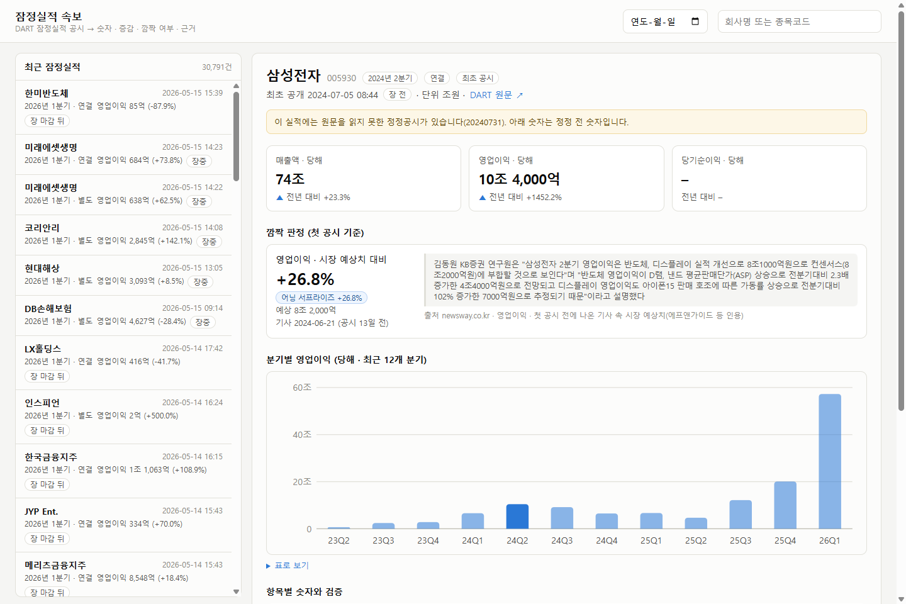
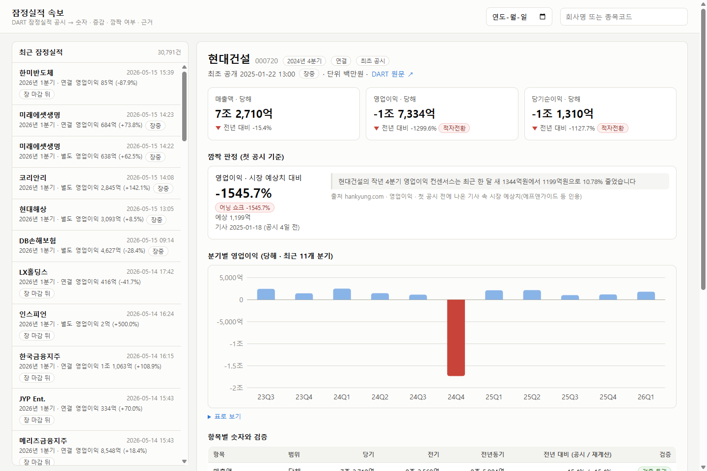
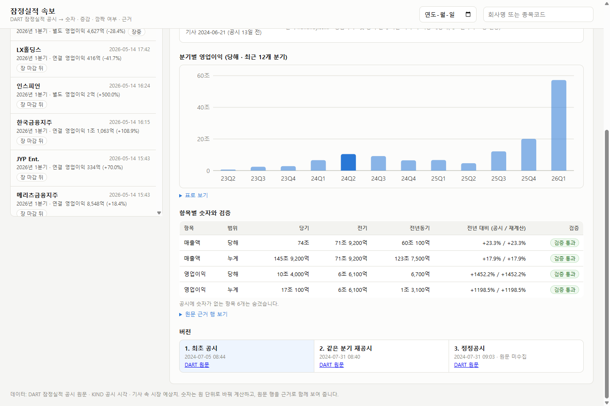
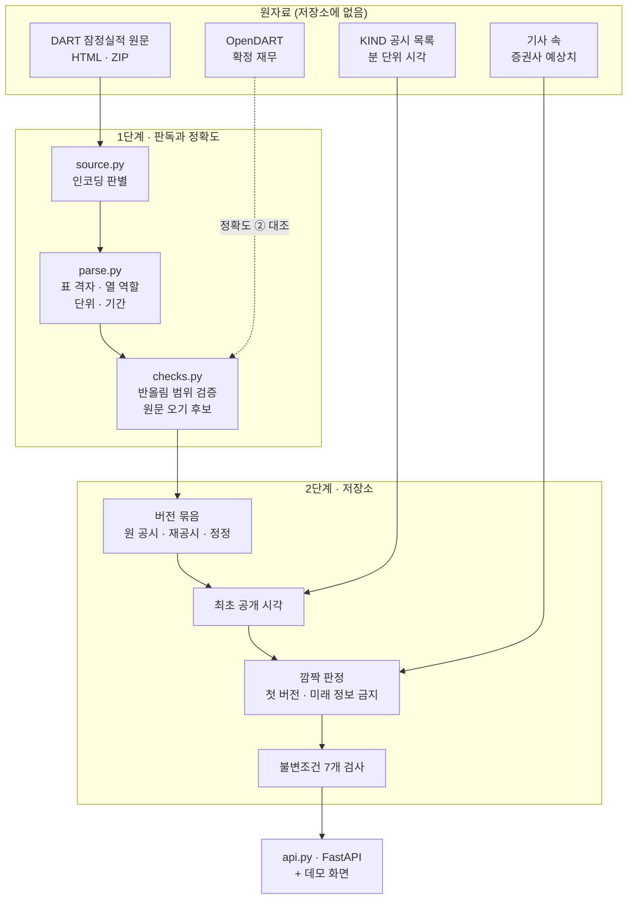

<div align="center">

# 📈 잠정실적 속보 API

**DART 잠정실적 공시를 숫자 · 증감 · 깜짝 여부 · 원문 근거로 바꿔 주는 API**

회사마다 표 모양 · 단위 · 기간 표기가 다른 잠정실적 공시 HTML을 읽어,<br/>
"얼마였고, 작년보다 얼마나 늘었고, 시장 예상보다 좋았나"를 **근거와 함께** 돌려줍니다.




<sub>데모 화면 — 삼성전자 2024년 2분기 첫 잠정실적. 영업이익 10조 4,000억 원, 공시 13일 전 기사 속 예상치 8조 2,000억 원보다 26.8% 높아 '어닝 서프라이즈'.</sub>

</div>

<br/>

## 목차

1. [왜 만들었나](#-왜-만들었나)
2. [한눈에 보기](#-한눈에-보기)
3. [정확도 — 정답 없이 재기](#-정확도--정답-없이-재기)
4. [지키는 규칙](#-지키는-규칙)
5. [화면](#-화면)
6. [API](#-api)
7. [동작 구조](#-동작-구조)
8. [설계에서 고민한 점](#-설계에서-고민한-점)
9. [한계](#-한계)
10. [실행](#-실행)

<br/>

## 🤔 왜 만들었나

잠정실적은 정기보고서보다 한 달쯤 먼저 나오는, **시장이 가장 먼저 보는 실적 숫자**입니다. 그런데 공시 원문은 사람이 읽으라고 만든 HTML이라 그대로는 데이터로 쓰기 어렵습니다.

- 표 모양이 제각각입니다. 합친 칸(rowspan · colspan), `1,041 44.8%` 처럼 증감액과 증감률을 한 칸에 적은 칸, 단위를 주석에서 바꾸는 공시("상기 금액은 조원 단위")가 있습니다.
- 기간 표기도 제각각입니다. `('26.1Q)` · `2016년 3Q` · `1Q24` · `'21.1분기` · `09.07.01~09.09.30` · `(2009.03)` 같은 표기를 모두 읽어야 합니다.
- 같은 실적이 여러 번 공시됩니다(요약 → 상세 재공시, 정정공시). 어느 숫자가 현재 값인지, 처음 공개된 시각이 언제인지 따로 관리해야 합니다.
- 숫자만으로는 부족합니다. 증권 포털 · 데이터 납품에서는 **이 숫자가 맞다는 근거**와 **예상보다 좋았는지**가 함께 필요합니다.

그래서 2008~2026년 잠정실적 공시 전체를 읽어 구조화하고, 정답 없이도 정확도를 재는 방법 세 가지를 만들었습니다.

<br/>

## 🔭 한눈에 보기

| | |
|---|---|
| **입력** | DART 잠정실적 공시 원문(HTML) · KIND 공시 시각 · OpenDART 확정 재무 · 기사 속 증권사 예상치 |
| **처리** | HTML 표 → 격자 → 열 역할 · 항목 · 단위 · 기간 판독 → 반올림 범위 검증 → 버전 묶음 · 공개 시각 · 깜짝 판정 |
| **출력** | 원 단위 숫자, 공시에 적힌 증감률과 다시 계산한 증감률, 검증 결과, 원문 오기 후보, 원문 근거 행, 버전 목록, 깜짝 판정 |
| **규모** | 공시 32,581건 중 **32,569건(99.96%)** 판독, 항목 행 29만 개 |
| **제공** | FastAPI(목록 · 공시 한 건 · 회사별 · 기간별 · 검색) + 데모 화면 |

<br/>

## 🎯 정확도 — 정답 없이 재기

사람이 만든 정답표가 없어서, **정답 없이 쓸 수 있는 세 가지 방법**으로 쟀습니다. 자세한 내용은 [1단계 보고서](reports/phase1_accuracy.md)에 있습니다.

| 방법 | 무엇을 확인하나 | 결과 |
|---|---|---|
| **① 공시 안의 증감률과 맞추기** | 뽑은 두 숫자로 다시 계산한 증감률이 공시에 적힌 값과 반올림 범위 안에서 겹치는가 | **99.5%** 일치 (228,991행) |
| **② 확정 재무와 맞추기** | 이미 확정된 '전년동기' 값이 정기보고서(OpenDART, 원 단위)와 같은가 — **단위까지** 검증 | **97.25%** 가 0.5% 안 (118,113행) |
| **③ AI 대리 정답과 맞추기** | AI(Codex)가 원문을 읽어 만든 매출 정답 457쌍 *(사람 검수 아님)* | 당기 100%, 비교값까지 99.3% |

**맞지 않는 곳의 상당수는 원문 쪽 오기였습니다.** 흔한 오기를 고친 값으로 다시 맞춰 보고, 맞으면 원래 값은 그대로 둔 채 "원문 오기 의심 + 고친 값"을 함께 남깁니다(414행).

| 공시 | 원문 | 고친 값 | 유형 |
|---|---|---|---|
| 삼성SDI 2008-10 매출 | `17.227` | 17,227 | 쉼표 자리에 점 |
| SJG세종 2008-05 영업이익 증감률 | `12,0%` | 12.0% | 소수점 자리에 쉼표 |

② 에서 10의 거듭제곱 배로 어긋난 40건은 모두 원인을 확인했습니다. 파서가 단위를 잘못 읽은 경우는 없었고, 원문 표의 단위 오기 6건 · OpenDART 쪽 단위 · 계정 문제 10건 등이었습니다.

<br/>

## 🛡 지키는 규칙

데이터를 만들 때마다 아래 7가지를 검사하고, 하나라도 어기면 빌드가 실패합니다(`scripts/build_store.py`, 종료 코드 1). 현재 **위반 0건**입니다.

| 규칙 | 깨지면 생기는 일 |
|---|---|
| 근거(원문 행 글자) 없는 숫자를 내보내지 않는다 | 어디서 나온 숫자인지 설명할 수 없다 |
| 실적 묶음마다 '현재 값'은 정확히 하나 | 같은 분기에 숫자가 둘 |
| 최초 공개 시각은 묶음 안에서 하나이고, 정정으로 바뀌지 않는다 | "언제 처음 알려졌나"가 정정 때마다 바뀐다 |
| 어떤 버전도 최초 공개보다 먼저 공개되지 않았다 | 버전 순서가 뒤집힌다 |
| 예상치 기사는 최초 공개보다 먼저 나왔다 | 발표된 숫자를 '예상치'로 쓰는 미래 정보 |
| 깜짝 판정은 첫 버전에만 | 재공시 · 정정 숫자로 깜짝 여부를 다시 매긴다 |
| 원문 숫자가 있으면 원 단위 값도 있다 | 단위를 모르는 금액이 섞인다 |

<br/>

## 🖼 화면

`GET /` 에서 열리는 데모 화면입니다. 실제 API 응답만으로 그립니다.



<sub>현대건설 2024년 4분기 — 영업손실 1조 7,334억 원. 공시 4일 전 기사 속 예상치(영업이익 1,199억 원)와 비교해 '어닝 쇼크'. 막대는 손실이면 빨강, 이익이면 파랑입니다.</sub>



<sub>항목별 숫자와 검증 결과, 그리고 버전. 같은 분기를 7월 5일(요약) · 7월 31일(상세)에 두 번 공시했고, 이어 정정공시가 있었습니다. 정정공시 원문은 모으지 못해 '원문 미수집'으로 표시합니다.</sub>

<br/>

## 🔌 API

| 요청 | 하는 일 |
|---|---|
| `GET /v1/filings?date=&exclude_monthly=&limit=&offset=` | 최근 잠정실적 목록(최초 공개 시각 순) |
| `GET /v1/filings/{rcept_no}` | 공시 한 건: 항목별 숫자 · 증감률(공시 / 재계산) · 검증 · 원문 오기 후보 · 근거 · 버전 · 깜짝 판정 |
| `GET /v1/companies/{stock_code}/earnings` | 한 회사의 기간별 현재 값(최근 순, 연결 우선) |
| `GET /v1/companies/{stock_code}/earnings/{period}` | 기간 하나(`2024Q2` · `2023FY` · `2016M04`) |
| `GET /v1/search?q=` | 회사명 · 종목코드 찾기 |

기간 조회는 "숫자를 못 줬다"를 오류로 뭉뚱그리지 않고 **이유를 상태로** 돌려줍니다.

| status | 뜻 |
|---|---|
| `OK` | 마지막 버전의 숫자 |
| `CORRECTION_NOT_REFLECTED` | 원문을 못 읽은 정정공시가 있음 → 정정 전 숫자 + 경고. 정정 전 숫자를 현재 값인 척하지 않는다 |
| `NOT_YET` | 마지막으로 공시한 기간보다 뒤 — 아직 공시 전(오류 아님) |
| `NOT_FOUND` | 그보다 앞인데 공시를 못 찾음 — 잠정실적을 안 낸 기간이거나, 기간 표시를 못 읽은 공시 |
| `NUMBERS_NOT_AVAILABLE` | 묶음에 원문을 읽은 버전이 없음 |

```text
GET /v1/companies/005930/earnings/2024Q2

{"status": "CORRECTION_NOT_REFLECTED",
 "warning": "이 기간에는 원문을 읽지 못한 정정공시가 있어, 정정 전 숫자를 보여 준다: 20240731800047 (20240731)",
 "surprise_at_first_release": {"surprise_label": "어닝 서프라이즈", "surprise_pct": 26.83,
                               "consensus_krw": 8200000000000, "consensus_published_at": "2024-06-21 15:58:00", ...},
 "current": {"rcept_no": "20240731800039", "first_published_at": "2024-07-05 08:44", "time_cat": "장 전",
             "headline": {"operating_income": {"current_krw": 10443900000000, ...}, ...},
             "metrics": [ ... 항목별 숫자 · 증감률(공시 · 재계산) · 검증 · 근거 ... ],
             "versions": [initial 07-05 → repeat 07-31 → correction 07-31]}}
```

<br/>

## 🧩 동작 구조



```text
src/prelim/
  source.py    공시 목록 · 원문 ZIP 읽기, 인코딩(UTF-8 / CP949) 판별
  parse.py     HTML 표 → 격자 → 열 역할 · 항목 · 단위 · 기간
  checks.py    증감률 · 증감액 반올림 범위 검증, 원문 오기 후보
  store.py     버전 묶음 · KIND 공개 시각 · 깜짝 판정 · 불변조건 검사
  api.py       FastAPI
  web/index.html   데모 화면(빌드 도구 없는 HTML 한 장)
scripts/run_phase1.py    전체 판독 + 세 가지 정확도 측정 → reports/phase1_*
scripts/build_store.py   API 가 읽는 표 + 불변조건 검사 → reports/phase2_*
tests/                   판독 · 검증 · 기간 표기 · API 시나리오
```

<br/>

## 💡 설계에서 고민한 점

**글자를 긁지 않고 표를 펼친다.** 정규식으로 숫자를 긁으면 합친 칸에서 열이 밀립니다. HTML 표를 rowspan · colspan까지 펼친 격자로 만든 뒤, '구분'으로 시작하는 머리글 줄에서 열의 뜻(당기 · 전기 · 전년동기 · 증감률 · 흑자/적자 전환)을 정합니다.

**반올림 범위로 검증한다.** 금액도 증감률도 반올림된 값이라 "다시 계산한 값 = 적힌 값"으로 비교하면 멀쩡한 행이 틀린 것으로 나옵니다. 두 값의 반올림 범위가 겹치는지로 판정하고, 회사마다 다른 관행(버림 · 부호 없는 감소 · 손실일 때 절댓값으로 나누기)은 '관행 차이로 통과'로 따로 셉니다.

**모르면 모른다고 한다.** 기간을 못 읽은 공시를 접수일로 추정해 묶으면, 기간 표시 없이 매달 내는 보험사의 월별 공시가 '같은 분기 재공시'로 잘못 묶입니다(실제로 778개 묶음이 그렇게 됨). 그래서 원문에서 읽은 기간만 쓰고, 연도만 빠진 `(3분기)` 같은 경우에만 접수일로 연도를 채우며 그 사실을 `period_source`에 남깁니다. `(2009.03)`처럼 월별인지 분기인지 모호한 표기는 전기 칸 머리글과의 간격(1달 / 3달)으로 정합니다.

**깜짝 판정은 첫 공시 기준이다.** 삼성전자는 2024년 2분기를 7월 5일(요약) · 7월 31일(상세) 두 번 공시했습니다. 두 번째 공시 기준으로 예상치를 고르면 7월 7일 기사의 "10조4000억원을 발표하자"를 예상치로 잡아, 이미 나온 숫자와 비교하게 됩니다. 그래서 판정은 묶음의 첫 공시에만 하고, 그보다 먼저 나온 기사만 씁니다. 예상치 기사가 45일보다 오래됐거나 부호가 의심되면 숫자는 보여 주고 판정만 비웁니다.

<br/>

## ⚠ 한계

- **정정공시 원문이 없습니다.** 정정공시 2,118건은 목록에만 있고 원문을 모으지 않았습니다. 해당 기간은 `CORRECTION_NOT_REFLECTED`와 경고를 냅니다. OpenDART에서 원문을 받으면 대부분 해결됩니다.
- **AI 대리 정답은 사람 검수가 아닙니다.** ③ 의 정답 457쌍은 AI가 만든 것이고 매출만 다룹니다. ① · ② 는 정답 없이 재는 방법이라 이 한계가 없습니다.
- **예상치는 기사에서 뽑았습니다.** 유료 컨센서스 데이터가 아니라 기사에 인용된 증권사 예상치라, 깜짝 판정이 있는 공시는 258건뿐이고 기사가 자주 다루는 회사에 쏠려 있습니다.
- **기간 표시가 전혀 없는 공시**(원문을 읽은 공시의 4.2%)는 회사별 · 기간별 조회에서 빠집니다(공시 한 건 조회로는 볼 수 있음).
- 2002~2007년 옛 양식은 정확도 대상이 아닙니다.

<br/>

## 🚀 실행

```bash
pip install -e ".[api,dev]"
python -m pytest                      # 원자료 없이 돌아가는 테스트
PRELIM_DATA_ROOT=<데이터 폴더> PYTHONPATH=src python scripts/run_phase1.py   # 판독 + 정확도
PRELIM_DATA_ROOT=<데이터 폴더> PYTHONPATH=src python scripts/build_store.py  # 저장소 + 불변조건
PYTHONPATH=src uvicorn prelim.api:app --port 8100                            # http://127.0.0.1:8100
```

원자료(DART 공시 원문 · OpenDART 재무 · KIND 공시 목록 · 기사 예상치)는 이 저장소에 들어 있지 않습니다. 테스트는 원문 3건(`tests/fixtures`)과 합성 데이터로 돌아갑니다.
